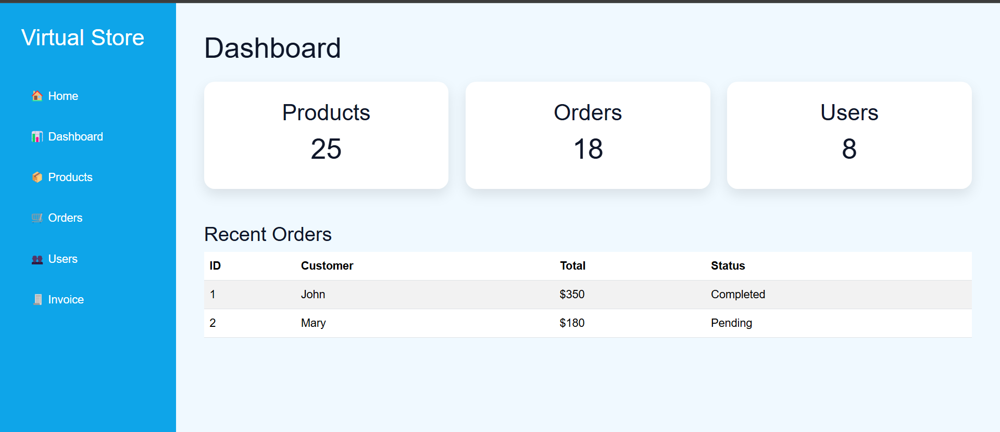
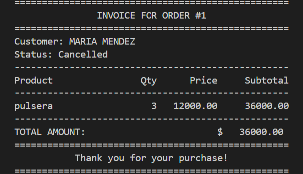
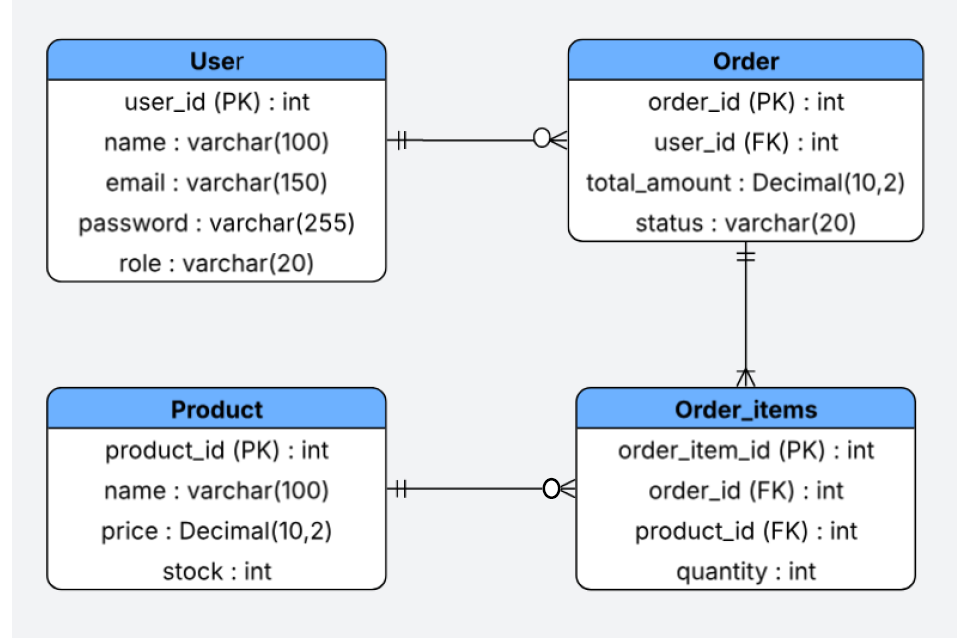
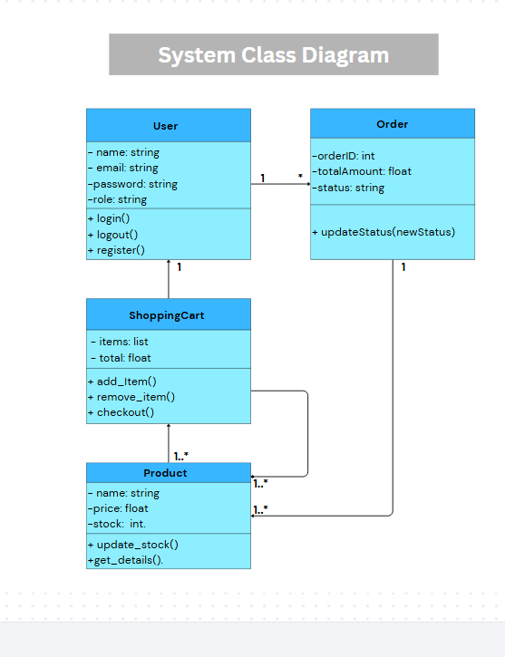

# 🛒 Virtual Store – Customer Order Management & Admin Dashboard

A full-stack web application designed to streamline the process of placing and tracking customer orders, managing inventory, and visualizing business metrics through a custom administrative dashboard.

Developed as part of my SENA Software Analysis and Development portfolio.

---

## 🎨 Frontend Overview

The application features a modern, responsive administrative dashboard that displays key business metrics, order statuses, and system modules.

<p align="center">
  
</p>

### Frontend Modules

- **Dashboard:** Overview of business metrics and system activity.
- **Products:** Product catalog and inventory management interface.
- **Orders:** Purchase history and order status tracking.
- **Users:** Customer account and profile management.
- **Invoices:** Billing information and transaction reports.

---

## 🚀 Project Scope & Backend Features

Virtual Store focuses on the end-to-end management of customer orders and inventory operations.

### Main Features

- **Customer Interaction:** Browse products and manage customer information.
- **User Management:** Register, authenticate, retrieve, update, and delete user accounts.
- **Product Management:** Create, retrieve, and manage product information.
- **Inventory Management:** Track product availability and stock levels.
- **Order Management:** Create orders and associate multiple products with a single transaction through relational database tables.
- **Invoice Generation:** Generate business invoices with calculated subtotals and order information.
- **Administrative Control:** Access inventory, customer records, and order information through the application interface.

---

## 📸 Visual Preview

The following image illustrates an example of an invoice generated by the system. It demonstrates how information from relational database tables can be combined to produce structured transaction reports.

<p align="center">
  
</p>

---

## 📊 Technical Design

### Database Design (ERD)

The Entity-Relationship Diagram (ERD) illustrates the database structure and relationships between users, products, and orders. It includes a junction table to represent the many-to-many relationship between orders and products.

<p align="center">
  
</p>

### System Architecture (UML)

The UML diagram represents the system architecture and the relationships between its main components, providing an overview of the application's organization and responsibilities.

<p align="center">
  
</p>

---

## 🛠️ Technical Stack

| Category | Technologies |
|---|---|
| Backend Framework | Python 3.x, FastAPI |
| Database | SQLite3 |
| Data Validation | Pydantic |
| Frontend | HTML5, CSS3, JavaScript |
| Templates | Jinja2 |
| Automated Testing | Pytest |
| API Documentation | FastAPI / Swagger UI |
| Version Control | Git and GitHub |
| Software Design | ERD and UML |

---

## ⚡ Quick Start

Follow these steps to set up the project locally.

### 1. Clone the repository

```bash
git clone https://github.com/Yenifer18-4200/YENNIFERMEJIA_AA3_EV01
cd YENNIFERMEJIA_AA3_EV01
```

### 2. Create a virtual environment

```bash
python -m venv .venv
```

### 3. Activate the virtual environment

**Windows (Git Bash):**

```bash
source .venv/Scripts/activate
```

**Windows (Command Prompt):**

```bash
.venv\Scripts\activate
```

### 4. Install dependencies

```bash
pip install -r requirements.txt
```

### 5. Run automated tests

```bash
python -m pytest -v
```

The project includes automated tests for the user management module.

**Current test results:** 10 tests passed successfully.

---

## 📂 Project Structure

The project follows a modular architecture that separates backend functionality, database design, frontend resources, HTML templates, utility scripts, and automated tests.

```text
YENNIFERMEJIA_AA3_EV01/
│
├── app/
│   ├── routers/
│   │   ├── orders.py          # Order management API endpoints
│   │   ├── products.py        # Product management API endpoints
│   │   └── users.py           # User management API endpoints
│   │
│   ├── database.py            # Database connection and configuration
│   ├── schemas.py             # Pydantic models and data validation
│   ├── security.py            # Password hashing and security utilities
│   └── server.py              # FastAPI server configuration
│
├── database_design/
│   ├── ERD_diagram.png        # Entity-Relationship Diagram
│   ├── UML_diagram.png        # System architecture diagram
│   └── requirements.md        # Software requirements documentation
│
├── scripts/
│   ├── create_tables.py       # Database table creation
│   ├── insert_order.py        # Order insertion utility
│   ├── insert_order_items.py  # Order-product relationship insertion
│   ├── insert_product.py      # Product insertion utility
│   └── insert_user.py         # User insertion utility
│
├── static/
│   ├── css/
│   │   └── styles.css         # Application styles
│   ├── img/                   # Images and visual resources
│   └── js/
│       └── main.js            # Frontend JavaScript functionality
│
├── templates/
│   ├── dashboard.html         # Administrative dashboard
│   ├── index.html             # Main application page
│   ├── invoice.html           # Invoice interface
│   ├── login.html             # Login interface
│   ├── orders.html            # Orders management interface
│   ├── products.html          # Products management interface
│   └── users.html             # Users management interface
│
├── tests/
│   └── test_users.py          # Automated user module tests
│
├── .gitignore                 # Git ignored files and directories
├── generate_invoice.py        # Invoice generation utility
├── inventory_view.py          # Inventory consultation utility
├── main.py                    # Application entry point
├── pytest.ini                 # Pytest configuration
├── requirements.txt           # Project dependencies
├── virtual_store.db           # SQLite database
├── LICENSE                    # Project license
└── README.md                  # Project documentation
```

---

## 👤 User Management Module

The Virtual Store application includes a RESTful API for user management, developed with FastAPI. This module provides the main operations required to manage customer accounts, including registration, authentication, data retrieval, updates, and deletion.

### API Endpoints

| HTTP Method | Endpoint | Description |
|---|---|---|
| `POST` | `/users` | Register a new user with a hashed password. |
| `POST` | `/users/login` | Authenticate users using their email and password. |
| `GET` | `/users` | Retrieve the list of registered users. |
| `GET` | `/users/{user_id}` | Retrieve a specific user by ID. |
| `PUT` | `/users/{user_id}` | Update a user's name and/or role. |
| `DELETE` | `/users/{user_id}` | Delete a user account by ID. |

### Security and Validation

- Passwords are hashed before being stored in the database.
- Email addresses are validated during registration.
- Duplicate email registrations are rejected.
- Password length requirements are enforced.
- User information is managed through structured API endpoints.

### Automated Testing

The user module includes automated tests covering registration, password hashing, authentication, data validation, and CRUD operations.

To execute the test suite, run:

```bash
python -m pytest -v
```

**Test Results:** 10 tests passed successfully.

---

## 📄 License

This project includes a license file in the repository. Refer to `LICENSE` for its terms.